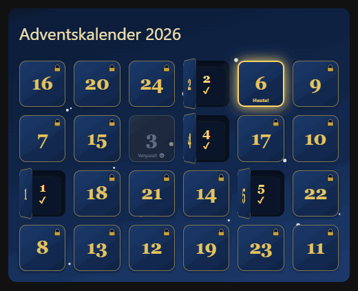

# 🎄 Adventskalender-Card für Home Assistant

Ein Adventskalender für dein Home-Assistant-Dashboard – gemacht für die deutschsprachige Community. Vom 1. bis 24. Dezember öffnet sich jeden Tag ein Türchen mit einem Tipp, einem Video oder einem Projekt rund um Home Assistant. Die Videos stammen von deutschsprachigen Home-Assistant-YouTubern, die dem Kalender ausdrücklich zugestimmt haben.



**Kostenlos, Open Source (MIT), ohne Konto und ohne Cloud.**

## Was die Karte kann

- 24 Türchen, die sich nur an ihrem Tag öffnen lassen – verpasste Türchen bleiben zu
- Jede Person in deinem Home Assistant hat ihren eigenen Öffnungsstand, auf Handy, Tablet und PC gleich
- Drei Looks: `winter`, `kids` und `nerd`, dazu auf Wunsch Schneefall
- Freiwillig: Beim Öffnen blinkt eine Lampe, startet einen Lichteffekt oder spielt Weihnachtsmusik – alles im visuellen Editor einstellbar
- Vor dem 1. Dezember ausprobieren mit einem Testdatum (nur für Admins)

## Installation

Voraussetzung: Home Assistant 2024.11 oder neuer.

### Über HACS (empfohlen)

Die Karte steht (noch) nicht im HACS-Standardverzeichnis, sondern wird als benutzerdefiniertes Repository hinzugefügt:

1. **HACS → ⋮ (oben rechts) → Benutzerdefinierte Repositories**
   - Repository: `https://github.com/jenser1/ha-advent-calendar-card`
   - Typ: **Dashboard**
2. In HACS nach **Adventskalender Card** suchen und herunterladen. Die Ressource trägt HACS selbst ein.
3. Browser neu laden (in der Companion-App: Einstellungen → Companion-App → Fehlerbehebung → Frontend-Cache zurücksetzen).

### Manuell

1. `advent-calendar-card.js` aus dem [neuesten Release](https://github.com/jenser1/ha-advent-calendar-card/releases/latest) nach `/config/www/` kopieren.
2. **Einstellungen → Dashboards → ⋮ → Ressourcen → Ressource hinzufügen**
   - URL: `/local/advent-calendar-card.js`
   - Typ: **JavaScript-Modul**
3. Browser neu laden.

## Einrichten

Dashboard bearbeiten → **Karte hinzufügen** → **Adventskalender** wählen. Alles Weitere stellst du im visuellen Editor ein – oder per YAML:

```yaml
type: custom:advent-calendar-card
theme: winter
snow: true
```

| Option         | Werte                    | Standard                     | Beschreibung                                         |
| -------------- | ------------------------ | ---------------------------- | ---------------------------------------------------- |
| `title`        | Text                     | `Adventskalender 2026`       | Überschrift; `""` blendet sie aus                    |
| `theme`        | `winter`, `kids`, `nerd` | `winter`                     | Look der Karte                                       |
| `snow`         | `true`/`false`           | `false`                      | Schneefall in der Karte                              |
| `shuffle`      | `true`/`false`           | `true`                       | Türchen pro Person fest gemischt                     |
| `empty_text`   | Text                     | „Heute ist das Türchen leer …“ | Text für Türchen ohne Inhalt                       |
| `effect_light` | Licht                    | –                            | Lampe beim Öffnen (siehe Licht und Musik)            |
| `effect_music` | Musik                    | –                            | Musik beim Öffnen (siehe Licht und Musik)            |
| `effect`       | Aktion(en)               | –                            | Eigene Aktionen oder ein Script (für Profis)         |
| `debug_date`   | Datum `JJJJ-MM-TT`       | –                            | Testdatum, wirkt nur für Admins (siehe Ausprobieren) |

### Looks

| Theme    | Look                                                                |
| -------- | ------------------------------------------------------------------- |
| `winter` | Nachthimmel in Blau mit goldenen Zahlen; hell: Eisblau mit Gold     |
| `kids`   | Jedes Türchen in einer anderen Farbe, große runde Zahlen            |
| `nerd`   | Terminal-Look in Grün auf Schwarz, Überschrift mit blinkendem Cursor |

`winter` und `kids` folgen dem hellen bzw. dunklen Design von Home Assistant. Ist am Gerät „Bewegung reduzieren“ eingestellt, gibt es weder Animationen noch Schnee.

### Licht und Musik

Im Editor gibt es im Bereich **Effekt beim ersten Öffnen**:

- **Licht:** eine Lampe, die bei jedem Türchen kurz blinkt oder einen Lichteffekt startet. Die Effekte kommen aus der Liste der Lampe (z. B. bei WLED „Rainbow“).
- **Musik:** ein Mediaplayer, ein Titel und auf Wunsch Lautstärke und Türchen (z. B. nur am 6. und 24.). Abspielen geht über Music Assistant (Titel, Album oder Playlist aus deiner Bibliothek oder die volle Adresse einer Datei) oder über den normalen Mediaplayer (Adresse einer Datei oder eines Streams).
- **Eigene MP3-Datei:** nach `/config/www/advent/` legen (am besten ohne Leerzeichen im Namen) und mit **voller** Adresse eintragen, z. B. `http://homeassistant.local:8123/local/advent/lied.mp3`. Nur der Dateiname oder `/local/…` reicht nicht, weil der Lautsprecher die Datei selbst abholen muss.
- **Erweitert: eigene Aktionen:** beliebige Aktionen oder ein Script, wie bei Automationen. Scripts bekommen `tag` (Nummer des Türchens) und `person` mit. Ein Beispiel steht in [`examples/scripts.yaml`](examples/scripts.yaml) (`advent_tuerchen`).

```yaml
type: custom:advent-calendar-card
effect_light:
  entity_id: light.wohnzimmer
  mode: effect          # flash (Standard) = kurz blinken, effect = Lichteffekt
  effect: Rainbow
effect_music:
  entity_id: media_player.wohnzimmer
  player: music_assistant   # oder media_player (Standard)
  media_id: Last Christmas
  volume: 30                # Prozent, weglassen = Lautstärke bleibt
  days: [6, 24]             # weglassen = an jedem Türchen
```

Effekte laufen nur beim **ersten** Öffnen eines Türchens und nur mit dem, was du selbst eingestellt hast. Die Inhalte des Kalenders können in deinem Home Assistant nichts auslösen.

### Ausprobieren vor dem 1. Dezember

```yaml
type: custom:advent-calendar-card
debug_date: "2026-12-24"
```

Mit `debug_date` tut die Karte so, als wäre dieser Tag – das gilt **nur für Admins**, alle anderen sehen das echte Datum. Im Testmodus geöffnete Türchen werden getrennt gespeichert; **Testdaten zurücksetzen** macht sie wieder zu. Für den echten Advent die Zeile einfach löschen.

### Wann sich ein Türchen öffnen lässt

„Heute“ ist das Datum in der Zeitzone von Home Assistant (Einstellungen → System → Allgemein), nicht die des Geräts.

| Status   | Wann                           | Anzeige                                   |
| -------- | ------------------------------ | ----------------------------------------- |
| gesperrt | Tag liegt in der Zukunft       | 🔒, beim Antippen „Noch X Tage!“          |
| öffenbar | heute ist der Tag              | leuchtet, „Heute!“                        |
| offen    | wurde geöffnet                 | aufgeklappt mit ✔, Inhalt jederzeit wieder ansehbar |
| verpasst | Tag ist vorbei, nie geöffnet   | grau, „Verpasst 😢“                        |

## Datenschutz

- **Keine Daten an mich:** Die Karte hat kein Backend, kein Tracking und keine Statistik. Die Türchen stecken fest in der JS-Datei.
- **Öffnungsstand:** Welche Türchen geöffnet sind, speichert dein eigener Home Assistant pro Benutzer (`frontend/set_user_data`, Schlüssel `advent_calendar_2026`).
- **YouTube:** Videos laufen im erweiterten Datenschutzmodus über `youtube-nocookie.com`. Der Player wird erst geladen, wenn du ein Türchen mit Video öffnest; Cookies setzt YouTube erst beim Abspielen.
- **GitHub-Links:** Bei Türchen mit GitHub-Projekt holt dein Browser Beschreibung und ⭐ über die öffentliche GitHub-API und merkt sie sich einen Tag lang.
- **Effekte:** Licht, Musik und eigene Aktionen laufen nur in deinem Home Assistant und nur so, wie du sie eingestellt hast.

## Fehler melden und Ideen

Am besten über die [GitHub-Issues](https://github.com/jenser1/ha-advent-calendar-card/issues/new/choose) – dort gibt es Vorlagen für **Fehler** und **Ideen**. Hilfreich sind die Version von Home Assistant und der Karte, Browser oder App und ein Bildschirmfoto. Bitte keine Inhalte kommender Türchen verraten 🤫

**Häufige Fragen**

- *Die Karte zeigt „Konfigurationsfehler“ mit `users`, `shared` oder `year`:* Diese Optionen gehören zur vollen Edition, die 2027 kommt. In der Version 2026 sehen alle denselben Kalender – die Zeilen einfach entfernen.
- *Die Karte fehlt im Kartendialog oder ist veraltet:* Browser-Cache leeren bzw. in der App den Frontend-Cache zurücksetzen.
- *Ein Türchen lässt sich nicht öffnen:* Die Karte nimmt das Datum aus der Zeitzone von Home Assistant, nicht vom Gerät.

## Ausblick 2027

2027 soll die **volle Edition** kommen: eigene Kalender pro Person mit eigenen Texten, Bildern, Rätseln, Gutscheinen und Effekten pro Türchen. Sie ist schon gebaut und beschrieben in [`docs/VOLLE-EDITION.md`](docs/VOLLE-EDITION.md).

## Entwicklung

Voraussetzung: Node.js 22.12 oder neuer.

```bash
npm install
npm run build       # Community-Edition → dist/advent-calendar-card.js
npm run build:full  # volle Edition mit eigenen Kalendern
npm run watch       # baut bei jeder Änderung neu (unminifiziert)
npm test            # Vitest, deckt beide Editionen ab
npm run typecheck   # TypeScript-Prüfung inkl. Tests
```

### Editionen

- **Community-Edition 2026** (`npm run build`): Die Türchen stecken fest in der Karte, alle sehen denselben Kalender. Die Inhalte kommen beim Bauen aus `content/2026.json`. Die Datei liegt nicht im Repository; fehlt sie, baut die Karte mit dem Platzhalter `content/beispiel.json` und warnt. `users`, `fallback`, `shared`, `content_source`, `json_path` und `year` führen zu einer Fehlermeldung, der Editor zeigt nur „Allgemein“. Effekte sind in den Inhalten verboten: Der Build bricht ab, und die Karte würde sie zusätzlich ignorieren. Erlaubt sind nur eigene Effekte (`effect_light`, `effect_music`, `effect`), die jeder selbst in seiner Karte einstellt.
- **Volle Edition** (`npm run build:full`): eigene Kalender pro Person, beschrieben in [`docs/VOLLE-EDITION.md`](docs/VOLLE-EDITION.md) – geplant für 2027.

Eine andere Inhaltsdatei lässt sich zum Testen mit `ADVENT_CONTENT` angeben, z. B. `npx rollup -c --environment ADVENT_CONTENT:content/test.json`. Mit `ADVENT_REQUIRE_CONTENT=1` bricht der Build ab, wenn nur der Beispielinhalt da ist, und nennt die noch leeren Türchen.

Die Türchen stehen in der fertigen JS-Datei leicht verschleiert (XOR + Base64) und werden erst beim Laden im Browser entschlüsselt. Das verhindert nur, dass man beim Durchblättern der Datei alle Überraschungen sieht – ein Schutz ist es nicht.

### Release

`dist/` liegt nicht im Repository. Ein Tag `vX.Y.Z` startet die GitHub Action: Sie prüft, ob der Tag zur Version in `package.json` passt, schreibt die echten Inhalte aus dem Secret `ADVENT_CONTENT_2026` nach `content/2026.json`, lässt Typecheck und Tests laufen, baut die Karte mit `ADVENT_REQUIRE_CONTENT=1`, hängt `advent-calendar-card.js` an ein neues Release und prüft das Repository mit der HACS-Validierung. Fehlt das Secret oder ist es kein gültiges JSON, gibt es kein Release.

Das Secret einmalig anlegen: im Repository unter **Settings → Secrets and variables → Actions → New repository secret**, Name `ADVENT_CONTENT_2026`, Wert = der komplette Inhalt von `content/2026.json`. Nach jeder Änderung an den Inhalten das Secret aktualisieren.

```bash
npm version 0.16.0
```

```bash
git push --follow-tags
```

## Lizenz

[MIT](LICENSE)
